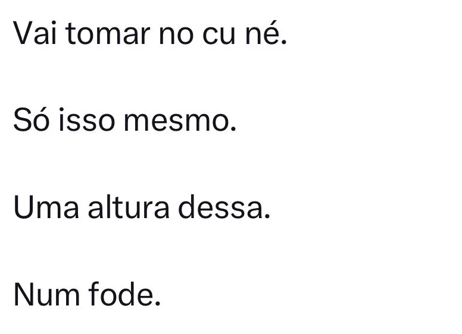

É no mínimo contraditório ver pessoas que se intitulam 'protetoras da democracia' e da liberdade de expressão fazendo um malabarismo mental inacreditável. Criam expectativas de que todo mundo precisa se posicionar politicamente a todo momento e, quando se deparam com um vídeo de alguém gritando por ajuda, desabafando e escancarando o óbvio — de que o mundo não gira em torno delas —, a reação é oprimir e xingar. Usar a dor alheia como palco para cobrança ideológica só prova uma coisa: a hipocrisia e a falta de empatia dessa gente são a verdadeira escória do país.

